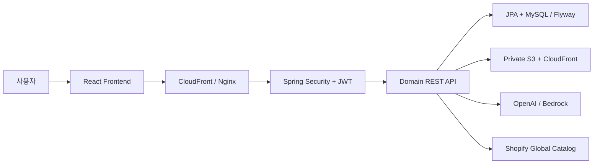
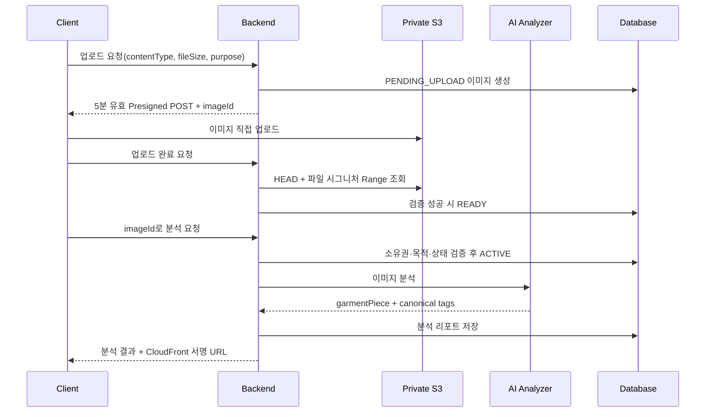
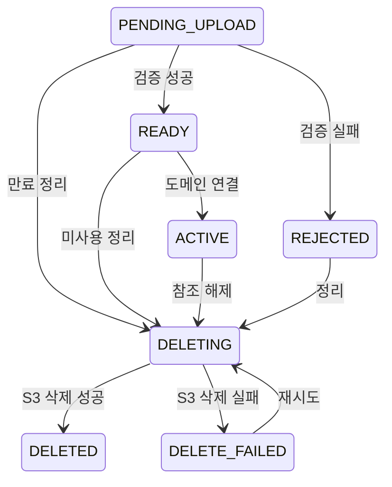

# FIT-BACK

> 옷 이미지를 분석해 스타일 태그와 상품 추천을 제공하고, 분석 결과를 룩북·트렌드·클로젯으로 확장하는 AI 패션 플랫폼입니다.

이 저장소는 팀 프로젝트 **FIT-BACK의 프론트엔드와 백엔드 최종 코드를 한곳에 모은 개인 포트폴리오용 통합 저장소**입니다. 전체 코드는 팀원들과 공동으로 개발했으며, 아래 두 조직 저장소의 최신 `main` 스냅샷을 기준으로 구성했습니다.

| 구성 | 원본 저장소 | 기준 커밋 |
| --- | --- | --- |
| Frontend | [FIT-BACK/frontend](https://github.com/FIT-BACK/frontend) | `fba84e5` (2026-08-20) |
| Backend | [FIT-BACK/backend](https://github.com/FIT-BACK/backend) | `11dc7c3` (2026-08-20) |

- 담당자: [jh0131](https://github.com/jh0131)
- 주요 담당: 분석 리포트 API, 이미지 업로드·수명주기, S3/CloudFront 연동, AI 분석기·CORS 운영 설정
- 서비스 성격: 모바일 중심 반응형 웹 + REST API

## 저장소 구성

```text
FitBack
├── frontend/    # React·TypeScript 클라이언트
├── backend/     # Spring Boot REST API와 배포 코드
└── README.md    # 전체 프로젝트 및 담당 파트 설명
```

각 애플리케이션의 기존 문서도 그대로 보존했습니다.

- [Frontend README](frontend/README.md)
- [Backend README](backend/README.md)
- [API 명세](backend/docs/API_SPEC.md)
- [운영 배포 문서](backend/docs/DEPLOYMENT.md)

## 프로젝트 소개

FIT-BACK은 사용자가 업로드한 패션 이미지를 AI로 분석해 표준 스타일 태그를 제안하고, 태그와 이미지 유사도를 바탕으로 상품을 추천하는 서비스입니다. 분석 결과를 저장하거나 룩북으로 공유할 수 있으며 트렌드, 통합 검색, 클로젯, 알림 기능을 함께 제공합니다.

### 주요 기능

- 이메일 회원가입, JWT 인증, 카카오 OAuth2 로그인, 비밀번호 재설정
- 이미지 직접 업로드, 실제 파일 검증, 비공개 이미지 서명 URL 발급
- 의류 이미지 AI 분석, 표준 태그 제안, 분석 리포트 저장·조회
- 태그·이미지 유사도 기반 상품 추천과 Shopify Global Catalog 조회
- 룩북 작성·조회·신고·좋아요와 트렌드 콘텐츠
- 클로젯 저장, 상품 저장, 알림, 통합 콘텐츠 검색
- AWS 기반 이미지·애플리케이션 배포와 자동 검증

## 기술 스택

| 영역 | 기술 |
| --- | --- |
| Frontend | React 19, TypeScript, Vite, React Router, TanStack Query, Zustand, Tailwind CSS |
| Backend | Java 21, Spring Boot 4.1.0, Spring MVC, Spring Data JPA, Spring Security |
| Database | MySQL, H2(test), Flyway |
| Authentication | JWT, OAuth2 Client, Kakao Login, BCrypt |
| AI / Catalog | OpenAI, Amazon Bedrock, Shopify Global Catalog |
| Storage / CDN | Amazon S3, CloudFront Signed URL |
| Infra | Docker, Docker Compose, Nginx, ECR, EC2, SSM, CloudWatch Logs |
| CI/CD | GitHub Actions, AWS OIDC |

## 서비스 구조



프론트엔드는 모바일 화면을 기준으로 한 최대 너비 480px의 반응형 UI이며, React Query로 서버 상태를 관리하고 Zustand로 클라이언트 상태를 분리합니다. 백엔드는 도메인별 controller·service·repository·entity 구조를 사용하고 공통 보안, 예외, 응답, 설정은 `global` 패키지에서 관리합니다.

## 프론트엔드 요약

프론트엔드는 로그인부터 이미지 업로드, 분석 대기·결과, 태그 편집, 추천 상품, 룩북, 마이클로젯까지 사용자의 전체 흐름을 제공합니다.

```text
frontend/src
├── api/          # 백엔드 API 요청
├── assets/       # 이미지와 아이콘
├── components/   # 공통·도메인 UI
├── constants/    # 공통 상수
├── hooks/        # 커스텀 훅
├── pages/        # 라우트별 페이지
├── store/        # 전역 상태
├── styles/       # 전역 스타일
├── types/        # TypeScript 타입
└── utils/        # 공통 유틸리티
```

## 백엔드 구조

```text
backend/src/main/java/com/fitback/backend
├── domain
│   ├── analysis          # 이미지 분석 및 리포트
│   ├── image             # 이미지 업로드·조회·정리
│   ├── recommendation    # 상품 추천
│   ├── product           # 상품 및 저장 상품
│   ├── member            # 회원·인증
│   ├── lookbook          # 룩북·좋아요·신고
│   ├── trend             # 트렌드 콘텐츠
│   ├── closet            # 클로젯 저장
│   ├── notification      # 알림
│   ├── contentsearch     # 통합 검색
│   └── tag               # 표준 태그
├── external
│   └── aitag             # OpenAI·Bedrock 어댑터와 표준 태그 계약
└── global                # 보안·설정·예외·공통 응답·관측성
```

## 담당 백엔드 파트

아래 내용은 원본 저장소의 작성자와 병합 이력을 기준으로 정리했습니다. 제가 분석·이미지 기능의 초기 구조와 운영 연결을 구현했고, 이후 팀 협업을 통해 추천·태그 계약과 예외 처리가 현재 `main` 수준으로 확장되었습니다.

### 1. 분석 리포트 API

사용자 이미지가 분석 리포트가 되기까지의 핵심 유스케이스와 계층 구조를 구현했습니다.

- `AnalysisController`에서 생성, 목록, 상세, 삭제 API 제공
- `CurrentMemberProvider`로 인증 사용자 ID를 서비스 계층에 전달
- 회원 소유 리포트만 조회·삭제하도록 repository query와 서비스 검증 구성
- `AiTagAnalyzer` 인터페이스로 분석 도메인과 실제 AI 공급자 분리
- AI가 반환한 표준 태그와 의류 부위(`garmentPiece`)를 리포트에 연결
- Entity setter 대신 생성 메서드와 상태 변경 메서드로 도메인 규칙 관리
- 삭제 시 화면에서는 즉시 제외하고 관계 데이터 정합성을 위해 soft delete 적용
- cursor 기반 목록 조회와 저장 리포트 상태를 현재 API로 확장

| Method | URI | 설명 |
| --- | --- | --- |
| `POST` | `/api/v1/analyses` | multipart 이미지 또는 운영용 `imageId`로 분석 생성 |
| `GET` | `/api/v1/analyses` | 내 저장 분석 목록 cursor 조회 |
| `GET` | `/api/v1/analyses/{reportId}` | 분석·추천 결과 상세 조회 |
| `DELETE` | `/api/v1/analyses/{reportId}` | 소유권 검증 후 분석 soft delete |
| `PUT` | `/api/v1/analyses/{reportId}/save` | 분석 결과와 선택 상품 저장 |
| `DELETE` | `/api/v1/analyses/{reportId}/save` | 저장 상태 해제 |

로컬 multipart 분석에서는 파일 저장 후 DB 트랜잭션이 롤백될 경우 저장 파일도 제거하도록 `TransactionSynchronization`을 등록했습니다. DB 커밋 단계에서 실패하는 경우까지 처리해 파일과 데이터베이스 사이의 불일치를 줄였습니다.

### 2. 이미지 직접 업로드와 수명주기

애플리케이션 서버가 이미지 바이너리를 중계하지 않도록 **S3 Presigned POST 기반 직접 업로드** 흐름을 설계하고 구현했습니다.



주요 설계 내용은 다음과 같습니다.

- JPEG, PNG, WebP만 허용하고 최대 크기를 5 MiB로 제한
- UUID와 회원·용도·날짜를 조합한 S3 object key 생성
- 업로드 완료 시 S3 metadata뿐 아니라 파일 앞부분의 magic byte 검증
- 요청값과 실제 S3 객체의 content type·크기가 다르면 `REJECTED` 처리
- 회원 소유권과 `ANALYSIS`·`PROFILE` 목적을 확인한 뒤에만 `ACTIVE` 전환
- 외부 S3 조회 동안 DB lock을 오래 잡지 않도록 조회와 상태 변경 트랜잭션 분리
- 비공개 이미지는 10분 유효 CloudFront Signed URL로만 조회
- 사용되지 않은 이미지를 batch로 선점한 뒤 삭제하고 실패 시 재시도



삭제 작업은 참조 중인 이미지를 먼저 제외하고, 24시간 이상 사용되지 않은 이미지를 최대 50개씩 처리합니다. 일시적 S3 오류는 `DELETE_FAILED`와 다음 재시도 시간을 기록해 다시 처리할 수 있게 했습니다.

| Method | URI | 설명 |
| --- | --- | --- |
| `POST` | `/api/v1/images/upload-requests` | Presigned POST와 `imageId` 발급 |
| `POST` | `/api/v1/images/{imageId}/complete` | S3 객체 검증 후 업로드 완료 |
| `POST` | `/api/v1/images/{imageId}/upload-request` | 만료 전 업로드 정보 재발급 |

### 3. AI 분석기·CORS 운영 설정

AI 분석기 선택과 CORS allowlist가 로컬 코드에 고정되지 않고 배포 환경에서 안전하게 주입되도록 운영 계약을 정리했습니다.

- `FITBACK_AI_TAG_ANALYZER`로 `unavailable`, `prototype`, `openai`, `bedrock` 선택
- 기본 운영값을 `unavailable`로 두어 잘못된 데모 태그가 쌓이지 않도록 fail-closed 처리
- OpenAI API key는 비밀값, model ID와 timeout은 비민감 runtime 설정으로 분리
- Bedrock은 장기 AWS key 대신 EC2 instance role로 `InvokeModel` 수행
- `APP_CORS_ALLOWED_ORIGINS`를 Repository Variable → 배포 payload → Compose → Spring Security까지 전달
- 빈 origin, 잘못된 AI mode, 누락된 model ID, 잘못된 timeout을 시작·배포 전에 검증
- workflow, 원격 배포 스크립트, Compose, production 설정의 변수 계약 테스트 추가

동일한 애플리케이션 이미지로 환경별 AI 공급자와 프론트엔드 origin을 선택하면서도 API key 같은 비밀값은 저장소와 GitHub Actions payload에 남기지 않도록 구성했습니다.

### 4. DB migration 안정화

운영 DB에 이미 적용된 Flyway `V22__seed_member_style_tags.sql`의 checksum이 바뀌지 않도록 원문을 복원했습니다. 이미 실행된 migration은 불변으로 유지하고 후속 변경은 새 버전으로 분리해 운영 기동 시 Flyway validation 실패를 방지했습니다.

## 주요 기여 이력

| 구분 | 내용 | 원본 PR |
| --- | --- | --- |
| 분석 | 분석 리포트 API와 이미지 분석 연동 | [#79](https://github.com/FIT-BACK/backend/pull/79) |
| 운영 설정 | 운영 CORS allowlist 환경변수화 | [#216](https://github.com/FIT-BACK/backend/pull/216) |
| AI 배포 | AI 분석기 선택·공급자별 환경변수 계약 | [#241](https://github.com/FIT-BACK/backend/pull/241) |
| Migration | 적용된 V22 migration 원문 복원 | [#245](https://github.com/FIT-BACK/backend/pull/245) |

## 실행 방법

### Frontend

```bash
cd frontend
pnpm install
pnpm dev
```

프로덕션 빌드와 lint는 다음 명령으로 확인합니다.

```bash
pnpm build
pnpm lint
```

### Backend

요구 사항은 JDK 21, MySQL 8.x입니다.

```bash
cd backend
cp .env.example .env
./gradlew bootRun --args='--spring.profiles.active=local'
```

Windows PowerShell에서는 다음 명령을 사용할 수 있습니다.

```powershell
Set-Location backend
Copy-Item .env.example .env
.\gradlew.bat bootRun --args="--spring.profiles.active=local"
```

로컬 MySQL에는 아래 데이터베이스를 먼저 생성합니다.

```sql
CREATE DATABASE fitback;
```

실제 비밀값은 커밋하지 않습니다. 필요한 변수는 [backend/.env.example](backend/.env.example)을 참고하세요. Swagger UI는 백엔드 실행 후 `http://localhost:8080/swagger-ui.html`에서 확인할 수 있습니다.

## 테스트와 빌드

```bash
cd backend
./gradlew clean build
```

백엔드 테스트는 `test` 프로필과 H2 인메모리 DB를 사용합니다. CI는 Gradle 테스트 외에도 배포 workflow 계약, Nginx 공개 진입점, 원격 배포 payload, MySQL 8.4의 Flyway `V1`~`V31` 적용을 검증합니다.

## 배포 구조

- Frontend: Vercel 배포
- Backend: GitHub Actions가 OIDC로 ECR 이미지를 발행하고 SSM Run Command로 EC2 Docker Compose stack 갱신
- Public entrypoint: CloudFront → Nginx; Spring Boot 8080 포트는 외부 비공개
- Image: private S3 저장, CloudFront Signed URL 조회
- Secret: AWS Systems Manager Parameter Store SecureString에서 EC2 instance role로 조회

> 이 개인 저장소에는 운영용 Repository Variable, AWS 권한, Parameter Store 비밀값이 포함되어 있지 않습니다. `backend/.github/workflows/backend-cd.yml`은 팀 프로젝트의 배포 설계를 보존한 코드이며, 개인 환경에서 실제 배포하려면 별도의 AWS 인프라와 권한 구성이 필요합니다.

## 협업 및 출처

본 프로젝트는 FIT-BACK 팀의 공동 결과물입니다. 개인 저장소에는 완성 시점의 프론트엔드와 백엔드 코드를 스냅샷으로 옮겼으며, 세부 공동 작업 이력과 코드 리뷰 과정은 [FIT-BACK 조직](https://github.com/FIT-BACK)의 원본 저장소에서 확인할 수 있습니다.
